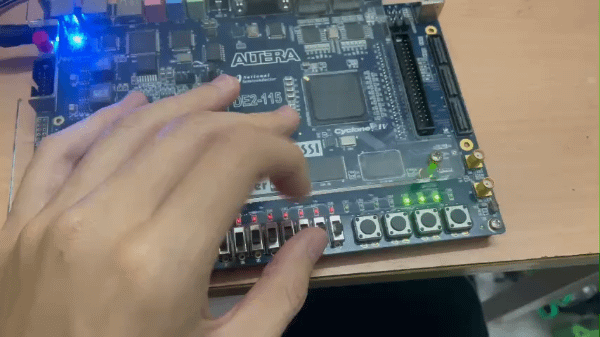
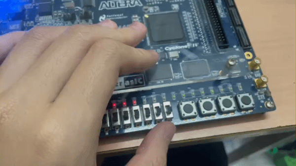

# Digital System Design Laboratory - Lab 1: Basic Combination Logic Circuits
This is technically my first time designing my own custom silicon chip (if you count wiring logic gates from scratch on an FPGA, which I absolutely do!).
This repository contains the Verilog HDL source code for 7 combinational logic circuit experiments, fully implemented and validated on physical hardware. 
* **Hardware:** Terasic DE2-115 FPGA Kit (Intel Cyclone IV E).
* **Source Code:** You can explore or download the Quartus project files and Verilog modules inside their respective experiment folders.

---

## Hardware Implementations & Demonstrations

Below are the real-world operational results after successfully programming the Verilog RTL onto the DE2-115 board.

### Experiment 1: Basic Logic Gates

* The circuit utilizes onboard SW switches for inputs and LEDG indicators to display the logic outputs.
* **Logic Gate LED Mapping**
The two input variables (`a` and `b`) are controlled by physical switches `SW[1]` and `SW[2]`. The outputs of the combinational logic circuits are mapped positionally to the green LEDs (`LEDG`) as follows:
* **LEDG[5]:** AND Gate (`SW[1] & SW[2]`)
* **LEDG[4]:** OR Gate (`SW[1] | SW[2]`)
* **LEDG[3]:** NOT Gate (`~SW[1]`)
* **LEDG[2]:** NAND Gate (`~(SW[1] & SW[2])`)
* **LEDG[1]:** NOR Gate (`~(SW[1] | SW[2])`)
* **LEDG[0]:** XOR Gate (`SW[1] ^ SW[2]`)

### Experiment 2: Half Adder Circuit

* The circuit implements a basic 1-bit Half Adder.
* **Logic & I/O Mapping**
The two input bits (`A` and `B`) are controlled by physical switches. The outputs are mapped to the LEDs as follows:
* **Sum (S):** XOR Gate logic (`A ^ B`)
* **Carry (Cout):** AND Gate logic (`A & B`)

### Experiment 3: Full Adder Circuit

* The circuit implements a 1-bit Full Adder with a carry-in input.
* **Logic & I/O Mapping**
The three input bits (`A`, `B`, and `Cin`) are controlled by switches. The outputs are mapped to the LEDs:
* **Sum (S):** `A ^ B ^ Cin`
* **Carry (Cout):** `(A & B) | (B & Cin) | (A & Cin)`

### Experiment 4: 4-Bit Ripple Carry Adder

* The circuit implements a 4-bit Ripple Carry Adder by cascading four 1-bit Full Adders in a structural model.
* **Logic & I/O Mapping**
* **Inputs:** Two 4-bit numbers (`A[3:0]` and `B[3:0]`) and an initial carry-in (`Cin`), controlled by switches.
* **Outputs:** A 4-bit sum (`S[3:0]`) and a final carry-out (`Cout`), mapped to the LEDs.

### Experiment 5: 2:1 Multiplexer Circuit

* The circuit implements a standard 2-to-1 Multiplexer.
* **Logic & I/O Mapping**
* **Inputs:** Two data lines (`i0`, `i1`) and one select line (`sel`).
* **Output (y):** Routes `i0` to the output if `sel = 0`, and `i1` if `sel = 1`.

### Experiment 6: 4:1 Multiplexer Circuit

* The circuit implements a 4-to-1 Multiplexer.
* **Logic & I/O Mapping**
* **Inputs:** Four data lines (`i0` to `i3`) and a 2-bit select line (`s[1:0]`).
* **Output (y):** Routes one of the four data inputs to the output based on the binary value of the select switches.

### Experiment 7: 16:1 Multiplexer Circuit

* This 16:1 multiplexer is built using a structural model assembled from five instances of the 4:1 MUX modules.
* **Logic & I/O Mapping**
* **Inputs:** Sixteen data lines (`D[15:0]`) and a 4-bit select line (`S[3:0]`).
* **Output (Y):** Routes one of the 16 inputs to the single output based on the select lines.
